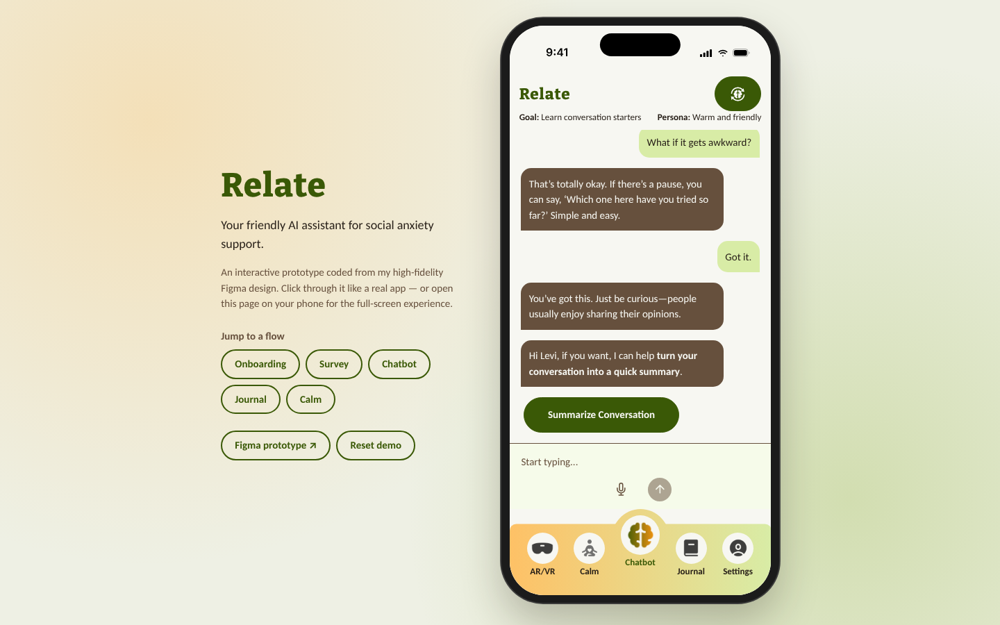

# Relate

**Your friendly AI assistant for social anxiety support.**

Relate is a mobile app concept that helps people with social anxiety prepare for real conversations. It includes a personalized chatbot, a mood and journal tracker, and guided calming techniques. This repo is a working, clickable version of my high-fidelity Figma prototype, coded so anyone can try the experience in a browser.

**[▶ Try the live demo](https://YOUR-USERNAME.github.io/YOUR-REPO/)** · [View the Figma prototype](https://www.figma.com/proto/jzCqAWExPS6Uxzjm3PvioO/DMD3035_SocialAnxietyAPP_Design?node-id=952-23465&starting-point-node-id=952%3A23465)



On a computer the app appears inside a phone frame with shortcuts to each flow. On a phone it runs full-screen like a native app.

## What you can do

| Flow | Highlights |
| --- | --- |
| **Onboarding** | Splash, feature tour, sign up / log in with validation, 6-digit email verification (enter `000000` to see the failure state) |
| **Survey** | Five questions using a draggable comfort meter, multi-select cards, and thought chips |
| **Chatbot** | Choose a goal and persona, then chat. Replies are scripted from the prototype, with typing indicators and suggested replies. Summarize the chat and save it to your journal |
| **Journal & mood** | Mood analytics, journal entries you can add, edit, and delete, emoji mood check-ins, and CSV export |
| **Calm** | Five breathing exercises with a live animated timer, and seven yoga poses |

Everything you enter is stored only in your own browser (localStorage). Use **Reset demo** to start over.

## Design → code

- Design tokens (colors, Bitter + Carlito type, radii) come straight from the Figma variables.
- Every screen was checked side by side against the Figma export.
- Interactions the static prototype could only suggest are real here: form validation, the drag meter, the breathing timer, persistent journal data, and the chatbot conversation.

## Tech

React 19 · Vite · React Router (hash routing for GitHub Pages) · plain CSS with custom properties · self-hosted fonts via Fontsource. There is no backend and no API keys.

## Run locally

```bash
npm install
npm run dev
```

## Deploy

Pushing to `main` builds the site and publishes it to GitHub Pages through `.github/workflows/deploy.yml`. To set it up once, go to **Settings → Pages → Source** and choose **GitHub Actions**.

## Project structure

```
src/
  components/   shared UI (buttons, inputs, tab bar, mood meter, icons)
  screens/      Onboarding, Chatbot, Journal, Calm
  state.jsx     demo data + localStorage persistence
  index.css     design tokens and styles
public/img/     icons and illustrations exported from Figma
```

Not yet coded: the AR/VR mock-practice flow and the Settings screens. Both tabs currently show a "coming soon" page.
